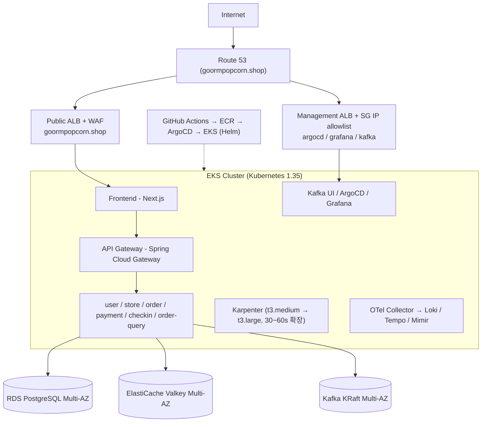

# Goorm Popcorn 인프라 설계서 (3차, EKS 기반)

> 원본: Notion "인프라 설계서" (Infra > 인프라 설계). 작성: 인프라·배포 설계 담당. 최초 작성 2026-02-06, 최종 수정 2026-02-22.

| 항목 | 내용 |
| --- | --- |
| 프로젝트 | Goorm Popcorn |
| 도메인 | goormpopcorn.shop |
| 목적 | 팝업 예약·주문·결제·QR·체크인을 연결하는 오프라인 이벤트 이커머스 플랫폼 |
| 아키텍처 | MSA |

## 설계 요약

| 영역 | 선택 |
| --- | --- |
| 컴퓨팅 | EKS + Karpenter |
| 이미지 레지스트리 | ECR |
| 데이터베이스 | RDS PostgreSQL |
| 캐시 | ElastiCache Valkey |
| 메시징 | EKS 내 Kafka (KRaft) |
| CI/CD | GitHub Actions + ArgoCD |
| 모니터링 | OpenTelemetry + LGTM Stack |

## 1. 전체 아키텍처

### 1.1 아키텍처 다이어그램



### 1.2 설계 원칙

1. **비용 효율성**: 예산 약 $340 / 3주
2. **확장성**: 순간 트래픽 100배 증가에 30~60초 내 대응
3. **고가용성**: Multi-AZ로 99.9% 가용성 목표
4. **표준 준수**: Kubernetes, OpenTelemetry 등 업계 표준 채택
5. **벤더 독립성**: 오픈소스 우선, 클라우드 종속 최소화

## 2. 컴퓨팅 플랫폼: Amazon EKS

### 선택 이유
- Kubernetes 표준 API로 벤더 종속 최소화, 필요 시 GKE/AKS로 이식 가능
- CNCF 생태계(Helm, Karpenter, ArgoCD) 활용
- 관리형 Control Plane으로 운영 부담 감소
- Karpenter로 30~60초 노드 확장

### 대안 비교
- **ECS (2차 프로젝트에서 사용)**: AWS 종속, Helm/ArgoCD 생태계 미지원, 확장 속도 2~5분
- **EC2 자체 구축 Kubernetes**: etcd·API Server·Controller Manager 직접 운영, 보안 패치·업그레이드 수동

### 선택 근거
- 비즈니스: 팝업 오픈 시 트래픽 급증 대응, 멀티 클라우드 전략 가능, GitOps 자동화로 배포 전략 다양화
- 기술: Karpenter 통합(ECS 대비 약 4배 빠른 확장), Helm 기반 Rolling/Blue-Green/Canary, ArgoCD GitOps(배포 실패율 목표 < 5%), OTel·LGTM 통합

### EKS 구성
- **Control Plane**: Kubernetes 1.35, Multi-AZ(ap-northeast-2a, 2c), AWS VPC CNI, Control Plane 로그는 CloudWatch Logs
- **Worker Nodes**: Karpenter 자동 프로비저닝, t3.medium / t3.large, Spot 활용, Multi-AZ 배치
- **Add-ons**: AWS Load Balancer Controller, EBS CSI Driver, VPC CNI, CoreDNS

### 2.4 도메인 라우팅: ALB 분리 전략

**문제**: 단일 ALB로 서비스 트래픽과 관리 도구 트래픽을 함께 처리하면
- 관리 도구(ArgoCD, Grafana, Kafka UI)가 퍼블릭 인터넷에 노출되고
- 공격 표면이 커지며
- 관리/서비스 트래픽이 섞인다.

**결정**: ALB 분리 + IP 허용 목록

| ALB | 대상 | 접근 제어 |
| --- | --- | --- |
| Public ALB | Frontend, API Gateway (`goormpopcorn.shop`) | 전체 공개 + WAF |
| Management ALB | `argocd.` / `grafana.` / `kafka.` 서브도메인 | `internet-facing`, Security Group으로 사내/VPN/개발자 IP만 허용 |

```text
                 Internet
          ┌─────────┴──────────┐
   Public ALB + WAF     Management ALB + SG IP allowlist
   goormpopcorn.shop    kafka./argocd./grafana.goormpopcorn.shop
   (전체 허용)           (사내/VPN/개발자 IP만)
          └─────────┬──────────┘
               EKS Cluster
   Frontend · API Gateway · Management Tools
```

## 3. 컨테이너 레지스트리: Amazon ECR

- **선택 이유**: EKS/IAM/VPC Endpoint 통합, 무제한 pull, push 시 자동 취약점 스캔, KMS 암호화, 라이프사이클 정책
- **대안**
  - Harbor: 무료·Trivy 통합이지만 PostgreSQL/Redis 등 부속 인프라와 HA·백업 운영 부담
  - Docker Hub: Private 레포 유료, pull 제한(익명 100/6h, 인증 200/6h), AWS 통합 없음
- **구성**
  - 레포 9개(API Gateway + 7 서비스 + frontend), 네이밍 `popcorn/{service-name}`, SemVer 태그(v1.0.0)
  - 보안: push 시 스캔, KMS 암호화, IRSA
  - 라이프사이클: 최근 10개 보존, untagged 7일 후 삭제, 오래된 이미지 30일 후 삭제
  - 비용: VPC Endpoint로 NAT 비용 절감

## 4. 데이터베이스: RDS PostgreSQL (Multi-AZ)

- **선택 이유**: 표준 PostgreSQL 100% 호환, Multi-AZ 자동 장애조치(< 60초), 자동 백업·PITR, Aurora 대비 약 40% 비용 절감
- **대안: Aurora PostgreSQL**: 스토리지 자동 확장·Read Replica 15개·빠른 복구 장점, 그러나 비용이 RDS 대비 약 67% 높고 최소 인스턴스(db.t3.medium) 제약
- **구성**

| 환경 | 인스턴스 | 스토리지 | 백업 |
| --- | --- | --- | --- |
| Dev | db.t4g.micro (Single-AZ) | 20GB gp3 | 1일 |
| Prod | db.t4g.micro (Multi-AZ) | 100GB gp3 | 7일, Read Replica 필요 시 추가 |

- 보안: TLS + KMS 암호화, Private Subnet, 자격증명은 Secrets Manager
- 모니터링: Enhanced Monitoring, Performance Insights, CloudWatch Alarms

## 5. 캐시: ElastiCache Valkey (Multi-AZ)

- **선택 이유**: Redis 100% 호환, Linux Foundation 오픈소스(라이선스 안정성), Multi-AZ 자동 장애조치, Redis 대비 낮은 비용
- **구성**: Dev `cache.t4g.micro` 단일 노드 / Prod `cache.t4g.small` Primary + Replica, 일일 백업 7일
- **용도**: 세션, API 응답 캐싱, Rate Limiting, 실시간 순위

## 6. 메시징: Kafka KRaft on EKS

### 선택 이유
- Kafka 100% 호환, KRaft 모드로 ZooKeeper 불필요
- MSK 대비 큰 비용 절감, 완전한 설정 제어
- 이벤트 소싱·CQRS 지원, GitOps/LGTM과 통합 운영

### 대안 비교

| 옵션 | 장점 | 단점 |
| --- | --- | --- |
| Amazon MSK | 완전 관리형, Multi-AZ 장애조치, 자동 패치, CloudWatch 통합 | 비용 매우 높음, 최소 3 브로커, 커스터마이징 제한 |
| EC2 Kafka KRaft | 단순, 전용 리소스, OS 튜닝 가능 | 수동 패치·스케일링·백업, 별도 모니터링, GitOps 미지원 |
| **EKS Kafka KRaft (채택)** | GitOps 선언적 배포, LGTM 통합(JMX 메트릭), HPA/Karpenter 활용, Velero 백업 | Stateful 워크로드 직접 운영 필요 |

### 아키텍처 관점
- Order Service → Kafka → Order Query Service (CQRS)
- Payment Service → Kafka → Order Service (이벤트 기반)
- 이벤트 소싱으로 감사 추적, OTel로 분산 트레이싱

### 배포 구성 (리소스는 상황에 맞게 조정)

| 환경 | 브로커 | 리소스 | 스토리지 | 복제 |
| --- | --- | --- | --- | --- |
| Dev | 1 Pod | 0.5 CPU / 1GB | 20GB PVC | 1 |
| Prod | 3 (Multi-AZ StatefulSet) | 1 CPU / 2GB (각) | 100GB PVC (각) | 3 |

### 6.4.1 Kafka 스토리지 전략

**문제**: EBS 볼륨은 단일 AZ에 고정된다. Kafka Pod가 다른 AZ로 스케줄되면 기존 볼륨을 마운트할 수 없고, StatefulSet만으로는 AZ 고정이 보장되지 않는다.

**1) StorageClass (EBS gp3)**

```yaml
apiVersion: storage.k8s.io/v1
kind: StorageClass
metadata:
  name: kafka-gp3-encrypted
provisioner: ebs.csi.aws.com
parameters:
  type: gp3
  iops: "3000"
  throughput: "125"
  encrypted: "true"
  kmsKeyId: "[REDACTED]"
volumeBindingMode: WaitForFirstConsumer  # Pod 스케줄 후 볼륨 생성
allowVolumeExpansion: true
reclaimPolicy: Retain                    # 실수로 인한 삭제 방지
```

gp3 선택 이유: gp2 대비 약 20% 저렴, 기본 3000 IOPS, 처리량 독립 설정.

| 볼륨 (100GB) | 월 비용 | 비고 |
| --- | --- | --- |
| gp3 (3000 IOPS, 125MB/s) | 약 $8 | 권장 |
| gp2 | 약 $10 | IOPS 300 (부족) |
| io2 (3000 IOPS) | 약 $207.5 | 과도 |

**2) StatefulSet AZ 분산/고정**

```yaml
affinity:
  podAntiAffinity:
    requiredDuringSchedulingIgnoredDuringExecution:
      - labelSelector:
          matchLabels: { app: kafka }
        topologyKey: kubernetes.io/hostname
  nodeAffinity:
    requiredDuringSchedulingIgnoredDuringExecution:
      nodeSelectorTerms:
        - matchExpressions:
            - key: topology.kubernetes.io/zone
              operator: In
              values: [ap-northeast-2a, ap-northeast-2c]
topologySpreadConstraints:
  - maxSkew: 1
    topologyKey: topology.kubernetes.io/zone
    whenUnsatisfiable: DoNotSchedule
    labelSelector:
      matchLabels: { app: kafka }
```

**3) 브로커별 AZ 고정 (권장)**: 브로커마다 StatefulSet을 분리하고 `topology.kubernetes.io/zone`을 하나로 고정(예: broker-0 → 2a).

**4) Karpenter NodePool**: Kafka 전용 NodePool(`workload: kafka`)에서 2a/2c, t3.medium/t3.large만 허용하고 consolidation 적용.

```yaml
apiVersion: karpenter.sh/v1beta1
kind: NodePool
metadata:
  name: kafka-nodes
spec:
  template:
    metadata:
      labels: { workload: kafka }
    spec:
      requirements:
        - key: topology.kubernetes.io/zone
          operator: In
          values: [ap-northeast-2a, ap-northeast-2c]
        - key: node.kubernetes.io/instance-type
          operator: In
          values: [t3.medium, t3.large]
      nodeClassRef: { name: default }
  limits: { cpu: 1000 }
  disruption:
    consolidationPolicy: WhenUnderutilized
    consolidateAfter: 30s
```

## 7. CI/CD: GitHub Actions + ArgoCD

- **선택 이유**: 코드 저장소와 CI 통합(OIDC), ArgoCD GitOps(Git = 단일 진실 소스), Helm 기반 배포 전략
- **대안**
  - Jenkins + ArgoCD: 플러그인 풍부, 그러나 플러그인·보안·업그레이드 운영 부담
  - GitLab CI + ArgoCD: 통합 플랫폼, 그러나 GitHub에서 마이그레이션 필요
  - AWS CodePipeline: AWS 네이티브, 그러나 AWS 종속, GitOps 미지원, Helm/K8s 통합 제한
- **이미지 빌드**: 현재 Frontend(Next.js)·Backend(Spring Boot) 모두 Buildx(`docker/build-push-action@v6`, `linux/amd64`)로 빌드

| 방식 | 빌드 속도 | Docker 필요 | 레이어 최적화 | 권장도 |
| --- | --- | --- | --- | --- |
| Jib | 매우 빠름 | 불필요 | 자동 | 5/5 |
| Docker Build | 느림 | 필요 | 수동 | 3/5 |
| Buildx | 느림 | 필요 | 자동 | 4/5 |

> 빌드 시간 실측 비교는 미완료.

## 8. 모니터링: LGTM Stack

- **선택 이유**: 로그·메트릭·트레이스 통합, OTel 네이티브, Kubernetes 네이티브, 오픈소스(벤더 독립)
- **대안**
  - ELK: 전문 검색 강점, 그러나 메모리 집약적·운영 복잡·스토리지 비용 3~5배, APM 별도
  - Datadog: 완전 관리형, 그러나 호스트 기반 고비용·벤더 종속
  - CloudWatch: AWS 네이티브, 그러나 쿼리 제약·X-Ray 별도·데이터 전송 비용
- **구성**: Loki(로그), Grafana(UI), Tempo(트레이스), Mimir(메트릭)
- **보존**: 로그 7일, 트레이스 7일, 메트릭 30일(상세)/1년(집계)
- **상관관계**: trace ID로 로그 필터링, span 기반 메트릭, 서비스 맵, 알림(Grafana Alerting → Discord)

## 9. 노드 오토스케일링: Karpenter

- **선택 이유**: 30~60초 노드 프로비저닝, Spot 지원(약 50% 절감), 워크로드에 맞는 인스턴스 자동 선택, Cluster Autoscaler 대비 약 4배 빠름
- **대안: Cluster Autoscaler**: 안정적이나 2~5분 확장, Node Group 단위 설정으로 인스턴스 선택 제한
- **인스턴스 전략**
  - 평상시: t3.medium (Spot 70% / On-Demand 30%)
  - 확장 시: t3.large 자동 추가
  - Multi-AZ 배치, Consolidation으로 유휴 리소스 회수

## 10. 배포 전략: Helm

- Umbrella Chart(`popcorn-umbrella`) + 서비스별 Sub-chart + 공통 라이브러리 차트(`common`)
- 환경별 values 오버라이드(`values-dev.yaml`, `values-prod.yaml`), 공통 설정은 `global`
- 보안: 민감 정보는 External Secrets Operator, 운영은 명시적 태그(latest 금지), 환경별 네임스페이스 + RBAC
- 리소스: 모든 컨테이너 requests/limits, HPA, 중요 서비스 Multi-AZ
- 헬스체크: liveness/readiness probe, Prometheus 메트릭 노출, 구조화 로그

## 11. 네트워킹

### VPC (10.0.0.0/16)

| AZ | Public | Private-App | Private-Data |
| --- | --- | --- | --- |
| ap-northeast-2a | 10.0.1.0/24 (ALB, NAT) | 10.0.11.0/24 (EKS Nodes, Kafka) | 10.0.21.0/24 (RDS, ElastiCache) |
| ap-northeast-2c | 10.0.2.0/24 (ALB, NAT) | 10.0.12.0/24 (EKS Nodes, Kafka) | 10.0.22.0/24 (RDS, ElastiCache) |

- **로드 밸런싱**: Multi-AZ ALB, ACM으로 TLS 종료, AWS Load Balancer Controller로 Ingress 연동
- **DNS**: Route 53, 서브도메인 `goormpopcorn.shop`(Frontend) / `kafka.` / `argocd.` / `grafana.`
- **Security Group**: ALB 80/443, RDS 5432·ElastiCache 6379·Kafka 9092는 EKS 노드에서만
- **VPC Endpoints**: ECR, S3, Secrets Manager

## 12. 보안

### 12.1 AWS WAF v2
- 보호 대상: 메인 도메인 및 관리 도메인
- AWS Managed Rules: Core Rule Set, Known Bad Inputs, IP Reputation, Rate Limiting
- 커스텀 규칙: 국가 기반 허용(KR, US, JP), API·파일 업로드 보호
- 모니터링/알림: 차단·허용·규칙별 매치 수, 비정상 트래픽 급증(1000% 이상), 특정 규칙 매치 급증

### 12.2 External Secrets Operator
- 기존 문제: Secret을 Git에 저장하는 위험, 수동 관리, 환경별 관리 복잡
- 구조: AWS Secrets Manager → (IRSA) → SecretStore/ExternalSecret(15분 refresh) → Kubernetes Secret 자동 생성
- Secrets Manager 경로 설계(값은 환경별로 다르며 문서에 포함하지 않음):

```text
popcorn/
├── database/
│   ├── common/        host, port, database
│   ├── user-auth/     app_username, app_password, flyway_username, flyway_password, schema
│   ├── order/         (동일 구조)
│   └── payment/       (동일 구조) ...
├── redis/             host, port, password, database
├── kafka/             bootstrap-servers, sasl-username, sasl-password
├── jwt/               secret-key, access-token-validity, refresh-token-validity
├── passport/          secret
└── payment/           base-url, secret-key, client-key, test-mode
```

### 12.3 ~ 12.6 기타
- IRSA로 서비스별 최소 권한, Pod Security Standards(Restricted: root 금지, 권한 상승 금지)
- 암호화: 전송 중 TLS 1.2+, 저장 시 RDS/ElastiCache/EBS/S3 KMS
- Network Policy로 Pod 간 통신·네임스페이스 격리
- 컨테이너 보안: ECR 자동 스캔, 고위험 취약점 배포 차단 (런타임 보안 Falco는 범위 외)

## 첨부 이미지
- 없음 (본 문서는 텍스트 다이어그램만 포함)
